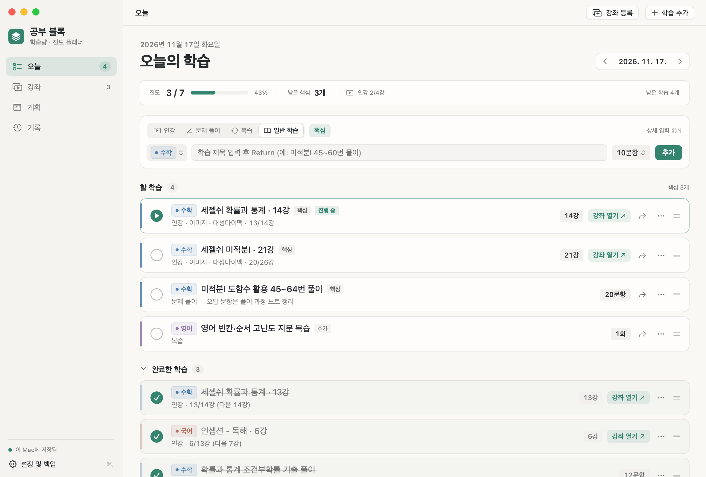
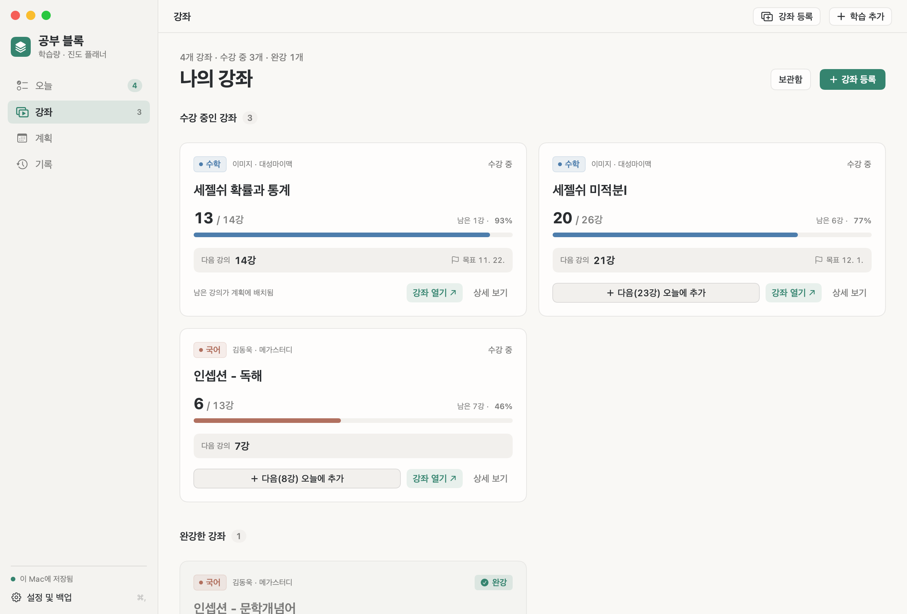
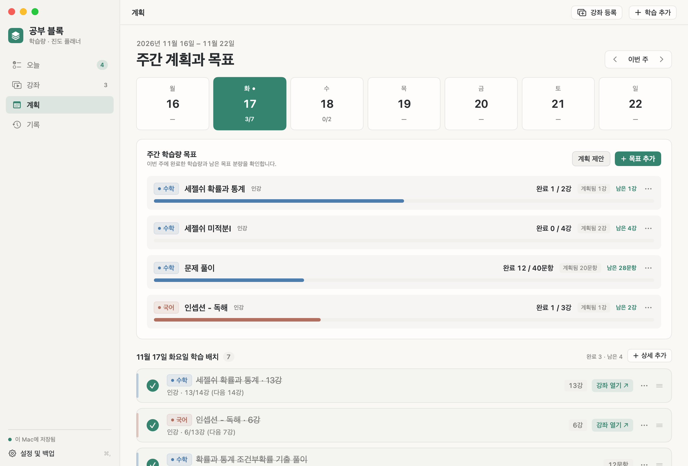
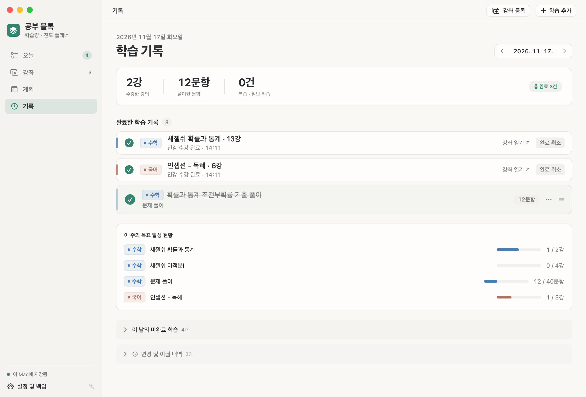
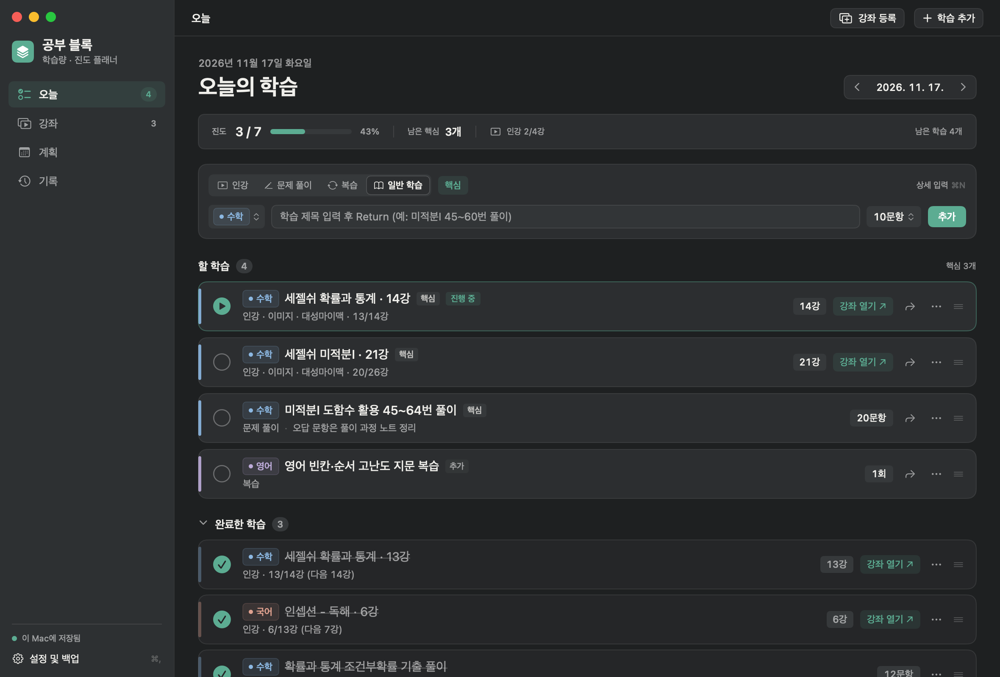

# Study Blocks (공부 블록)

Study Blocks(공부 블록)는 시간표나 타이머 대신 **학습량과 진도**를 중심으로 공부를 관리하는 macOS 전용 학습 플래너입니다.
SwiftUI와 SwiftData로 작성된 네이티브 애플리케이션이며, 외부 서버나 계정 연동 없이 모든 데이터를 사용자의 Mac에 로컬로 저장합니다.



---

## 핵심 기능

- **오늘의 학습 블록 관리**: 오늘 해야 할 인강, 문제 풀이, 복습, 일반 학습을 인덱스 카드 형태의 블록으로 정리하고 완료 상태를 전환합니다.
- **인강 수강 진도 및 다음 강의 자동 계산**: 전체 강의 수와 현재 완료한 진도를 입력하면 다음 계획 가능한 강의를 자동으로 계산하며, 오늘 화면과 강좌 카드에서 외부 인강 URL을 바로 열 수 있습니다.
- **인라인 빠른 추가와 상세 편집**: 모달 창을 열지 않고도 오늘 화면과 계획 화면 상단에서 인강이나 문제 풀이 블록을 한 줄로 추가할 수 있으며, `⌘N`으로 세부 설정을 포함한 등록도 지원합니다.
- **주간 학습량 목표와 계획 제안**: 이번 주에 끝낼 강의 수나 문제 수를 목표로 정하고, 완료한 분량·계획된 분량·남은 분량을 비교하며 규칙 기반 강의 배분 제안을 적용할 수 있습니다.
- **요일·간격 기반 반복 복습**: 특정 요일이나 일정 일수 간격으로 반복 복습 규칙을 등록하면 해당 날짜를 열 때 복습 블록을 자동으로 생성합니다.
- **학습 기록과 변경 이력 분리**: 날짜별로 실제 완료한 인강·문제 풀이·복습 기록을 모아 보고, 이월이나 날짜 변경 같은 시스템 내역은 별도로 구분해 확인합니다.
- **안전한 로컬 저장 및 JSON 백업**: 모든 중요한 변경은 트랜잭션으로 저장하며, 전체 데이터를 JSON 파일로 내보내거나 검증 후 복원할 수 있습니다.

---

## 화면 미리보기

### 나의 강좌 및 진도 관리


### 주간 계획과 목표


### 학습 기록과 다크 모드 (Index & Graphite)
| 학습 기록 | 다크 모드 (Graphite) |
| --- | --- |
|  |  |

---

## 지원 환경

- **운영체제**: macOS 14.0 (Sonoma) 이상
- **아키텍처**: Apple Silicon (`arm64`) 및 Intel (`x86_64`) Universal 바이너리
- **네트워크**: 불필요 (오프라인 환경에서 모든 기능 작동, 외부 강좌 URL 열기 시에만 브라우저 사용)

---

## 다운로드 및 설치

### 1. 실행 파일 다운로드
- [GitHub Releases](https://github.com/PastelJ321/Study_Blocks/releases) 페이지에서 최신 버전의 `StudyBlocks-macOS.zip`을 내려받습니다.
- 또는 저장소 내 [`Downloads/StudyBlocks-macOS.zip`](Downloads/StudyBlocks-macOS.zip) 파일을 내려받을 수 있습니다.
- 압축을 풀고 `StudyBlocks.app`을 `응용 프로그램(Applications)` 폴더나 원하는 위치로 옮겨 실행합니다.

### 2. 외부 Mac 실행 시 Gatekeeper 안내 (Ad hoc 서명)
이 프로젝트는 유료 Apple Developer Program 인증서 및 공증(Notarization)을 사용하지 않고, 오픈소스 로컬 빌드용 **ad hoc 서명**으로 패키징되어 있습니다.
따라서 직접 빌드하지 않고 내려받은 앱을 처음 실행할 때 macOS Gatekeeper 경고가 나타날 수 있습니다.

1. Finder에서 `StudyBlocks.app`을 **우클릭(Control-클릭) → 열기**를 선택합니다.
2. 또는 실행 차단 대화상자가 나타난 뒤 **시스템 설정 → 개인정보 보호 및 보안** 하단에서 **없이 열기**를 누릅니다.
3. 터미널을 사용할 경우 아래 명령으로 격리 속성을 제거한 뒤 열 수 있습니다.
   ```zsh
   xattr -cr /Applications/StudyBlocks.app
   ```

---

## 사용 방법

### 강좌 등록과 인강 수강 관리
1. 상단 툴바의 **강좌 등록(`⇧⌘N`)** 버튼을 눌러 강좌명, 과목, 전체 강의 수, 현재까지 완료한 강의 수를 입력합니다. 필요한 경우 강사, 플랫폼, 강좌 바로가기 URL(`https://...`), 완강 목표일을 함께 입력합니다.
2. **강좌** 화면의 카드에서 `다음(N강) 오늘에 추가`를 누르거나, **오늘** 화면 상단의 빠른 추가 바에서 `인강`을 선택하면 아직 계획에 넣지 않은 다음 강의 번호가 자동으로 선택됩니다.
3. 오늘 화면의 인강 블록 우측에 있는 **강좌 열기 ↗** 버튼을 눌러 외부 인강 사이트에서 강의를 수강합니다.
4. 수강을 마친 뒤 블록 좌측의 체크 원을 누르면 강의가 완료 처리되고, 강좌 진도와 다음 수강 강의 번호가 즉시 갱신됩니다.
5. 건너뛴 강의나 과거 수강 이력은 강좌 카드를 눌러 열리는 **강좌 상세** 화면의 강의 번호 그리드에서 개별적으로 완료·취소할 수 있습니다.

### 일반 학습 블록(문제 풀이·복습·일반 학습) 사용법
1. **빠른 추가**: 오늘 화면 또는 계획 화면 상단의 빠른 추가 바에서 유형(`문제 풀이`, `복습`, `일반 학습`)과 과목을 고르고, 제목과 분량(예: `20문항`, `1회`, `15쪽`)을 입력한 뒤 `Return` 키를 누릅니다.
2. **상세 추가(`⌘N`)**: 계획 날짜 지정, 핵심/추가 구분, 세부 메모가 필요한 경우 `⌘N`을 눌러 상세 입력 창에서 등록합니다.
3. **순서 변경 및 날짜 이동**:
   - 학습 블록 카드를 드래그하여 다른 카드 위에 놓으면 오늘의 학습 순서가 바뀝니다.
   - 카드 우측의 화살표 버튼(`다음 날로 미루기`)을 누르면 미완료 블록을 다음 날로 이월합니다.
   - **계획** 화면에서는 카드를 상단 요일 탭으로 드래그해 원하는 날짜로 바로 옮길 수 있습니다.
4. **강의 시청과 문제 풀이의 분리**: 인강 블록 완료는 강의 수강 진도만 갱신합니다. 강의와 관련된 문제 풀이나 복습은 별도의 `문제 풀이` 또는 `복습` 블록으로 등록해 독립적으로 관리합니다.

### 주요 키보드 단축키
| 단축키 | 동작 |
| --- | --- |
| `⌘N` | 상세 학습 블록 추가 |
| `⇧⌘N` | 새 강좌 등록 |
| `⌘1` ~ `⌘4` | 오늘 · 강좌 · 계획 · 기록 화면 이동 |
| `⌘T` | 오늘 날짜 및 오늘 화면으로 이동 |
| `⌘Z` | 마지막 완료 상태 변경 또는 날짜 이동 취소 |
| `⌘,` | 설정 및 백업 창 열기 |

---

## 데이터 저장 위치와 백업

### 저장 경로 및 데이터 기준
- **Bundle Identifier**: `com.pastelj.studyblocks`
- **SwiftData 저장소 경로**:
  ```text
  ~/Library/Application Support/com.pastelj.studyblocks/Study.store
  ```
- 앱 파일을 다른 폴더로 옮기거나 1.0.0에서 1.1로 업데이트해도 동일한 저장소 경로와 스키마(`StudySchemaV1`)를 사용하므로 기존 데이터가 그대로 유지됩니다.
- 날짜 계산은 시스템 시간대와 무관하게 **한국 표준시(`Asia/Seoul`)** 및 **월요일 시작 주간**을 기준으로 동작합니다.
- 인강 완료 여부는 `LessonCompletion`(강좌 ID + 강의 번호)을 단일 기준으로 삼아 모든 화면의 상태가 일치하도록 유지합니다. 처음 강좌를 등록할 때 입력한 기존 완료 강의 수는 `isInitial`로 구분되어 오늘이나 이번 주의 신규 학습량 통계에 중복 합산되지 않습니다.

### JSON 백업 및 복원
- **설정(`⌘,`)** 또는 상단 메뉴의 **파일 → JSON 백업 내보내기 / 가져오기**에서 전체 데이터를 JSON 파일로 관리할 수 있습니다.
- 백업 파일에는 강좌, 강의 완료 이력, 학습 블록, 주간 목표, 반복 규칙, 변경 내역이 모두 포함됩니다.
- **백업 가져오기(복원)** 실행 시 파일 크기(최대 20MB), 레코드 수(최대 100,000개), 버전, ID 중복, 참조 무결성을 먼저 검사합니다.
- 복원 확인 후에는 기존 데이터를 `~/Library/Application Support/com.pastelj.studyblocks/Backups/before-restore-<UUID>.json`에 먼저 자동 백업한 뒤 데이터를 교체하며, 저장 중 오류가 발생하면 변경 전체를 롤백합니다.
- SQLite 기반 저장소 파일을 직접 복사할 때는 반드시 앱을 종료한 상태에서 `Study.store`, `Study.store-wal`, `Study.store-shm` 세 파일을 함께 복사해야 합니다.

---

## 소스 코드 빌드 및 테스트

### 요구 사항
- macOS 14.0 이상
- Xcode 16 이상 (Command Line Tools 포함)

### 터미널에서 테스트 실행
SwiftData 인메모리/디스크 단위 테스트(17개 XCTest)와 별도 프로세스 간 영구 저장 검증(`PersistenceProbe`)을 실행합니다.
```zsh
./Tools/test.sh
```

### 터미널에서 Release 앱 및 배포용 ZIP 빌드
Apple Silicon(`arm64`)과 Intel(`x86_64`)을 모두 지원하는 Universal 바이너리 앱을 빌드하고 서명을 검증한 뒤 ZIP 파일을 생성합니다.
```zsh
./Tools/build.sh
```
빌드가 완료되면 다음 경로에 산출물이 생성됩니다.
- 실행 앱: `build/StudyBlocks.app`
- 배포 패키지: `build/StudyBlocks-macOS.zip` (및 `Downloads/StudyBlocks-macOS.zip`)

### Xcode에서 열기
`StudyBlocks.xcodeproj` 파일을 Xcode로 열고 `StudyBlocks` 스킴을 선택한 뒤 `Run(⌘R)`을 실행합니다.
프로젝트 파일 구조를 재생성해야 할 때는 `python3 Tools/generate_project.py`를 사용할 수 있습니다.

---

## 라이선스

이 프로젝트는 [MIT License](LICENSE)에 따라 배포되는 오픈소스 소프트웨어입니다. 누구나 라이선스 조건에 따라 소스 코드를 사용, 수정, 재배포할 수 있습니다.

---

## 프로젝트 및 저작권 정보

- **프로젝트**: Study Blocks (공부 블록) — QuadraJ Project
- **저작권**: Copyright © 2026 [PastelJ321](https://github.com/PastelJ321)
- **저장소**: [https://github.com/PastelJ321/Study_Blocks](https://github.com/PastelJ321/Study_Blocks)
